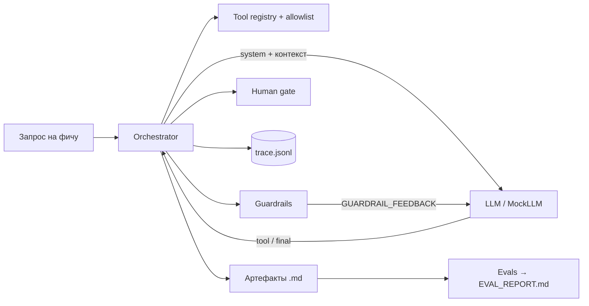

# dmharness — harness для AI-агента системного аналитика

[](https://github.com/<your-user>/datamart-spec-harness/actions)
 

Рабочий пример **harness** вокруг LLM-агента для задачи из роли *Senior System Analyst* в команде фреймворка
разработки витрин данных: по запросу на фичу агент проходит конвейер

`Research → CJM → HLD → ФТ/НФТ → ТЗ`

и выдаёт согласованный комплект документов. Каждый этап проверяется автоматически, а не «на доверии к модели».

> **Что такое harness.** Модель — это «мозг»; harness — всё остальное, что превращает её в надёжную систему:
> цикл исполнения, инструменты, контекст/память, guardrails, бюджеты, человек в контуре, трассировка и оценка качества.
> Этот репозиторий — минимальная, но полная реализация всех этих слоёв без внешних зависимостей.

## Быстрый старт (≈ 1 минута, без API-ключа)

```bash
git clone https://github.com/<your-user>/datamart-spec-harness.git
cd datamart-spec-harness
python3 -m unittest discover -s tests            # 19 тестов
python3 -m dmharness run examples/feature_request.md
```

Требуется только Python 3.10+. Результат — в папке `out/`:

| Файл | Содержимое |
|---|---|
| `01_research.md` | паспорта источников, оценка нагрузки |
| `02_cjm.md` | персоны, карта пути, метрики CSI |
| `03_architecture.md` | HLD: компоненты, Mermaid-диаграмма, trade-offs, сценарии отказов |
| `04_requirements.md` | ФТ и измеримые НФТ с ID |
| `05_tz.md` | ТЗ с трассировкой на все требования, приёмка, тесты, демо, документация |
| `EVAL_REPORT.md` | оценка прогона и нарушения guardrails по этапам |
| `trace.jsonl` | полный трейс: каждый вызов LLM и инструмента |

## Демо-сценарии

```bash
# 1. Основной прогон
python3 -m dmharness run examples/feature_request.md

# 2. Самокоррекция: «модель» выдаёт неизмеримое НФТ → guardrail отклоняет → агент исправляет
python3 -m dmharness run examples/feature_request.md --out out_fault --inject-fault

# 3. What-if: меняем требования — меняется архитектура (Flink/ClickHouse → Spark/StarRocks)
python3 -m dmharness run examples/feature_request.md --out out_whatif \
    --set concurrent_users=300 --set freshness_sla_seconds=900

# 4. Бюджеты: агент не может выйти за лимит ходов (код возврата 1, причина в отчёте)
python3 -m dmharness run examples/feature_request.md --out out_budget --max-steps 2

# 5. Человек в контуре: подтверждение или замечание после каждого этапа
python3 -m dmharness run examples/feature_request.md --out out_hitl --interactive

# Реестр инструментов
python3 -m dmharness tools
```

Сценарий выступления на 5 минут — в [`docs/DEMO.md`](docs/DEMO.md).

## Реальная модель

```bash
export ANTHROPIC_API_KEY=...        # опционально: DMH_MODEL=<model-id>
python3 -m dmharness run examples/feature_request.md --provider anthropic --out out_llm
```

Тот же цикл, те же инструменты и guardrails, но документы пишет модель. Если она нарушит формат или требования,
harness вернёт ей `GUARDRAIL_FEEDBACK` и даст ограниченное число попыток.

> **Честно об ограничениях.** В режиме `mock` документы собираются из шаблонов по данным инструментов — цель режима
> показать *механику harness* (цикл, инструменты, guardrails, бюджеты, трассировка), а не качество текста.
> Каталог данных в `examples/` — учебный. Это демонстрационный проект, не production-система.

## Архитектура



Подробнее: [`docs/ARCHITECTURE.md`](docs/ARCHITECTURE.md).

| Слой harness | Где реализован |
|---|---|
| Цикл агента и протокол `<tool>` / `<final>` | `dmharness/orchestrator.py`, `dmharness/llm.py` |
| Инструменты (типизированные, allowlist по этапам) | `dmharness/tools.py` |
| Контекст: каждый этап видит только нужные артефакты | `dmharness/stages.py` (`INPUTS`) |
| Guardrails: разделы, диаграмма, измеримые НФТ, трассировка, PII | `dmharness/guardrails.py` |
| Бюджеты: ходы на этап, ретраи, общий лимит вызовов | `dmharness/config.py` |
| Человек в контуре | `--interactive`, `Orchestrator.approve` |
| Наблюдаемость | `dmharness/tracing.py` → `trace.jsonl` |
| Оценка качества | `dmharness/evals.py` → `EVAL_REPORT.md` |

## Как расширять

- **Новый инструмент:** функция с декоратором `@reg.register(...)` в `tools.py`, добавить имя в `tools` нужного этапа.
- **Новый этап:** `Stage(...)` в `stages.py` + (для mock) шаблон в `mock_docs.py`.
- **Новый guardrail:** функция `(doc, ctx) -> list[str]` в `guardrails.py` и добавление в `extra_validators`.
- **Свой запрос:** любой markdown с секцией `## Параметры` (см. `examples/feature_request.md`).

## Структура

```
dmharness/        ядро (orchestrator, llm, tools, guardrails, stages, evals, tracing, cli)
examples/         запрос на фичу и учебный каталог данных
tests/            19 тестов (unittest)
docs/             архитектура и сценарий демо
.github/          CI (тесты + демо-прогон)
Dockerfile, Makefile, pyproject.toml, LICENSE
```

## Соответствие задачам роли

| Из описания вакансии | Как показано в проекте |
|---|---|
| Анализ потребности, CSI | `02_cjm.md`: метрики CSI, time-to-first-datamart, доля витрин с DQ |
| CJM, HLD, ФТ/НФТ, ТЗ | конвейер из 5 этапов + проверки качества документов |
| Микросервисы, HLD/LLD | компоненты и отказы в `03_architecture.md`, Config Service как отдельный сервис |
| Harness AI-агента | весь репозиторий |
| Hadoop / Greenplum / ClickHouse / Spark / Flink / StarRocks | инструмент `select_engine` с проверяемыми правилами выбора |
| Тестирование, демо, документация | раздел «План тестирования и демо» и «Пользовательская документация» в ТЗ, `docs/DEMO.md` |

## Лицензия

MIT
