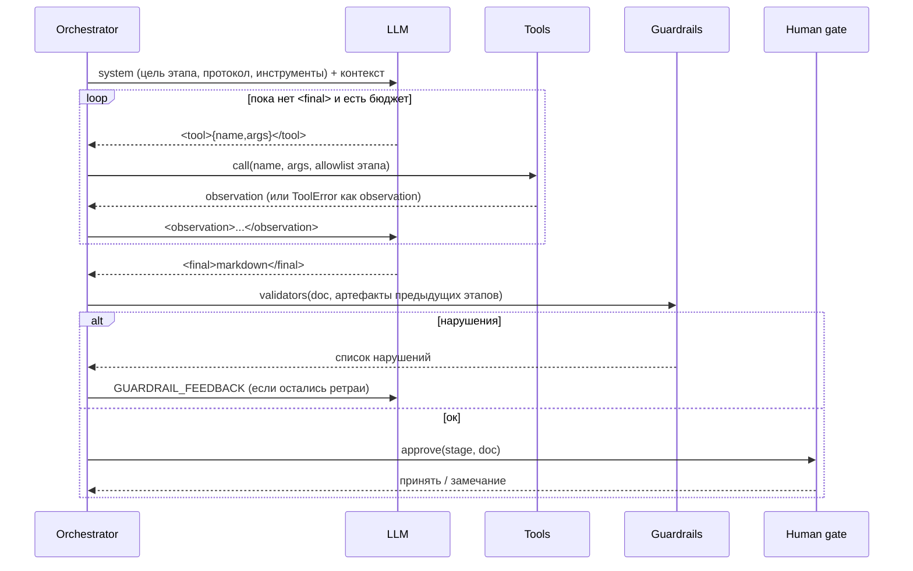

# Архитектура dmharness

## 1. Цикл одного этапа

## 2. Принципы

1. **Модель не доверенная.** Любой артефакт проходит детерминированные проверки: обязательные разделы,
   диаграмма Mermaid, числовые пороги у каждого НФТ, трассировка ТЗ на ФТ/НФТ, отсутствие PII.
2. **Инструменты — единственный источник чисел.** Нагрузка, выбор стека и DQ-правила считаются кодом, а не «придумываются».
3. **Ошибки — это observation.** Неверный вызов инструмента или формат ответа возвращается модели как обратная связь,
   прогон не падает.
4. **Бюджеты жёсткие.** Лимит ходов на этап, ретраев и общих вызовов; при превышении — понятный отказ с причиной.
5. **Ограниченный контекст.** Этап видит только нужные артефакты (`INPUTS`), что снижает шум и стоимость.
6. **Всё наблюдаемо.** `trace.jsonl` содержит каждый вызов LLM, инструмента, результат guardrails и решение человека.
7. **Качество измеримо.** `evals.py` проверяет сквозную согласованность: движок из HLD встречается в ТЗ, НФТ измеримы, трассировка полная.

## 3. Решения и компромиссы (ADR-кратко)

| Решение | Альтернатива | Почему так |
|---|---|---|
| Свой протокол `<tool>/<final>` | нативный tool-use API провайдера | Переносимость между провайдерами и markdown без экранирования JSON; цена — собственный парсер |
| Линейный конвейер этапов | граф (LangGraph) с ветвлениями | Предсказуемость и простота аудита; граф оправдан при параллельных ветках и условных переходах |
| Валидаторы на регулярных выражениях | LLM-as-judge | Дёшево, детерминированно, воспроизводимо; judge добавляется поверх для смысловой оценки |
| Файлы + JSONL | БД / Langfuse | Ноль инфраструктуры для демо; для production — OpenTelemetry/Langfuse |
| `MockLLM` по тому же интерфейсу | записанные ответы | Тесты проверяют именно механику harness (ретраи, бюджеты, allowlist) |

## 4. Режимы отказа

| Сбой | Реакция harness |
|---|---|
| Невалидный формат ответа модели | `GUARDRAIL_FEEDBACK`, ход расходуется из бюджета |
| Вызов запрещённого/несуществующего инструмента | `ToolError` → observation |
| Неизмеримое НФТ, пропуск раздела, «дыра» в трассировке | отклонение + ретрай; после лимита — `StageFailed` |
| Зацикливание модели | `BudgetExceeded` по ходам этапа или общему лимиту |
| Человек отклонил этап | `HUMAN_FEEDBACK` + повтор в пределах ретраев |

## 5. Путь к production

- Оркестрация: Temporal/LangGraph (персистентное состояние, повторы, ветвления, параллельные этапы).
- Контекст: RAG по корпоративным стандартам ТЗ/HLD и реальному каталогу данных вместо учебного JSON.
- Оценка: LLM-as-judge с рубрикой + регрессионный набор эталонных запросов; метрики в CI.
- Безопасность: песочница инструментов, секреты в vault, политика данных (PII не уходит в модель).
- Наблюдаемость: OpenTelemetry-трейсы, стоимость и латентность на этап, алерты на рост ретраев.
