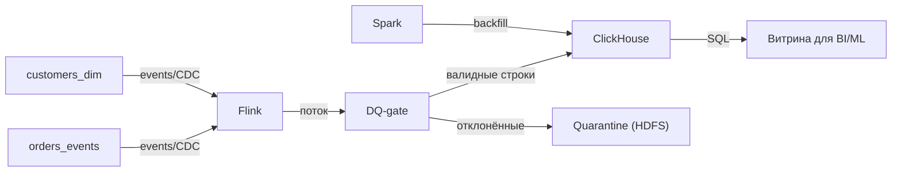

# HLD: Декларативный DQ-gate и инкрементальная загрузка витрины (стрим → ClickHouse)

## Контекст и цели
Фича встраивается в фреймворк витрин как новый слой: описание → загрузка → DQ-gate → публикация.
Цель — сократить time-to-first-datamart и количество инцидентов качества; SLA свежести 60 с.

Выбранный контур: ingest=Flink; serving=ClickHouse; batch=Spark

## Компоненты
| Компонент | Ответственность | Технология |
|---|---|---|
| Config Service | Валидация и версионирование YAML, генерация DDL | Python / FastAPI |
| Ingest | Инкрементальная загрузка, event-time, watermarks | Flink |
| DQ-gate | Исполнение правил до публикации, карантин | Flink SQL / UDF |
| Serving | Хранение витрины и выдача потребителям | ClickHouse — ReplacingMergeTree + argMax/FINAL по версии |
| Backfill | Пересчёт истории без остановки потока | Spark + Airflow |
| Quarantine | Отклонённые записи с причиной | HDFS (Parquet) |
| Observability | Метрики лага/DQ, lineage | Prometheus / каталог данных |

## Диаграмма

## Выбор технологий и trade-offs
- SLA свежести 60 с ≤ 300 с → потоковая обработка во Flink (checkpoint-и, exactly-once, event-time, watermarks).
- Upsert при 50 одновременных запросах (< 100) → ClickHouse ReplacingMergeTree; дедупликация по версии на чтении/слиянии.
- Объём 3.31 ТБ (сжатый): холодный слой — не требуется.
- Backfill и тяжёлые пересчёты истории — Spark-джобы с идемпотентной записью.
- Альтернатива: Spark Structured Streaming вместо Flink — проще эксплуатация, но выше задержка; отвергнуто из-за SLA.
- Альтернатива: проверки внутри хранилища после загрузки — проще, но «битые» данные уже видны потребителям.

## Отказоустойчивость
| Сбой | Поведение | Восстановление |
|---|---|---|
| Падение Flink-джоба | Рестарт с checkpoint, повторная обработка | Идемпотентный upsert по ключу и версии |
| Недоступность ClickHouse | Буферизация в Kafka, рост лага | Алерт по лагу > SLA, автоматический догон |
| Всплеск нарушений DQ | Строки уходят в Quarantine, витрина жива | Алерт владельцу, повторная обработка после фикса |
| Ошибка в новой конфигурации | Версия не активируется | Rollback на предыдущую версию |
